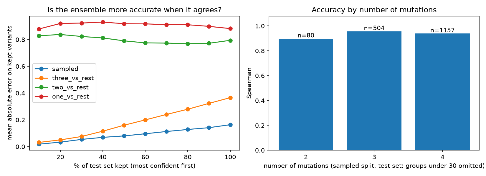
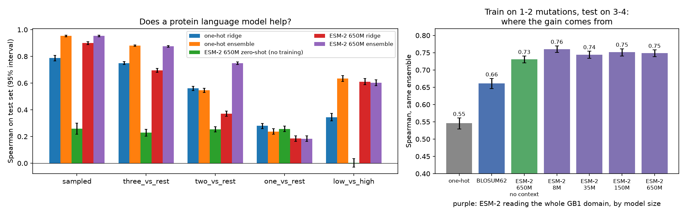
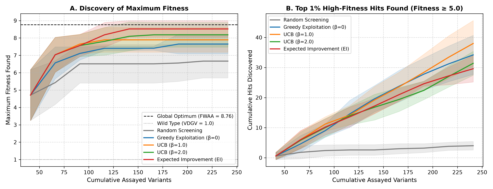
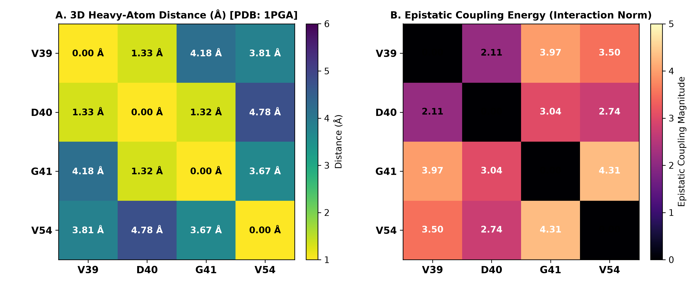

# gb1-fitness

Can a model trained on simple protein variants predict complex ones, and does it know when it is wrong?

I trained small neural networks to predict protein fitness on the GB1 landscape and tested them
on splits that force extrapolation from fewer mutations to more. The short answer: networks capture
interactions between mutations very well when they have seen combinations, do no better than an
additive model when they have not, and their confidence stops meaning anything in exactly that case.

[Part 2](#part-2-does-a-protein-language-model-help) adds the protein language model ESM-2. It lifts the
model trained on single and double mutants from 0.55 to 0.76, but about half of that gain comes from simply
knowing which amino acids resemble each other, model size makes no difference, and the confidence problem remains.

[Part 3](#part-3-in-silico-directed-evolution--active-learning) replays an active learning campaign in silico, where each "assay" looks up a measured fitness. With 40 starting variants and 240 assays in total, Expected Improvement found the best variant (`FWAA`, fitness 8.76) in 4 of 5 seeds, against 1 of 5 for greedy selection and 0 of 5 for random screening. Five seeds is too few for firm rankings between strategies.

[Part 4](#part-4-3d-structural-biophysics--epistasis-mapping) maps the 4 mutated positions onto crystal structures (PDB `1PGA`, and `1FCC`, which holds the closely related C2 domain bound to an antibody Fc fragment). The four positions lie close together and touch the Fc interface. Distance does not predict pairwise epistasis: across the 6 pairs, rank correlation is 0.14.

## Data

GB1 from the [FLIP benchmark](https://github.com/J-SNACKKB/FLIP/tree/main/splits/gb1): variants of
protein GB1 mutated at four positions (V39, D40, G41, V54), each with a fitness value from a binding
assay (Wu et al., eLife 2016). The original landscape covers about 160,000 variants; each FLIP split
file contains 8,733. About a third of variants are non-functional (fitness below 0.1), and almost none
fall between 0.1 and 0.5, so fitness is closer to two populations than one smooth scale
(`fitness_hist.png`).

| Split | Trained on | Tested on |
|---|---|---|
| sampled | random 80% | random 20% |
| three_vs_rest | 0 to 3 mutations | 4 mutations |
| two_vs_rest | 0 to 2 mutations | 3 and 4 |
| one_vs_rest | 0 and 1 mutation | 2, 3 and 4 |
| low_vs_high | variants worse than wild type | the rest |

## Method

- **Input:** the four varying positions, one-hot encoded (80 numbers). The other 261 positions never change.
- **Additive baseline:** ridge regression. Each mutation contributes a fixed amount regardless of the others.
- **Network without ReLU:** the same network with the non-linearities removed, which makes it additive too.
- **MLP:** two hidden layers of 128 units with ReLU, trained with Adam and mean squared error.
- **Early stopping:** the FLIP validation rows are held out of training; each model keeps the weights
  from its epoch with the lowest validation loss (patience 25, at most 300 epochs).
- **Seeds:** every network is trained five times with different seeds.
- **Ensemble:** the average of the five MLPs. Their disagreement (standard deviation) is used as uncertainty.
- **Metric:** Spearman correlation on the test set. Intervals are 95% bootstrap intervals over test
  variants (1,000 resamples). Network rows without intervals report mean ± standard deviation across seeds.

## Results

| Split | Train / val / test | Additive (ridge) | Network without ReLU | MLP, 5 seeds | Ensemble of 5 |
|---|---|---|---|---|---|
| sampled | 6289 / 699 / 1745 | 0.788 [0.766, 0.807] | 0.787 ± 0.002 | 0.945 ± 0.002 | **0.954** [0.948, 0.959] |
| three_vs_rest | 2691 / 299 / 5743 | 0.750 [0.738, 0.760] | 0.753 ± 0.005 | 0.869 ± 0.004 | **0.881** [0.876, 0.886] |
| two_vs_rest | 381 / 43 / 8309 | **0.561** [0.545, 0.576] | 0.547 ± 0.007 | 0.520 ± 0.022 | 0.546 [0.529, 0.561] |
| one_vs_rest | 25 / 3 / 8705 | **0.280** [0.259, 0.297] | 0.171 ± 0.052 | 0.195 ± 0.064 | 0.238 [0.217, 0.259] |
| low_vs_high | 4580 / 509 / 3644 | 0.345 [0.317, 0.374] | 0.338 ± 0.011 | 0.579 ± 0.008 | **0.635** [0.613, 0.656] |



Left: mean absolute error on the test variants the ensemble is most confident about, adding less
confident ones from left to right. Right: accuracy by number of mutations on the random split.

## What I found

1. **The gain comes from interactions between mutations (epistasis).** Removing the ReLU layers drops the
   network to the additive model's score (0.787 against 0.788). Everything the MLP gains above that is
   non-additive structure.
2. **Networks only learn interactions they have seen.** With triple mutants in training, the MLP beats the
   additive model by a wide margin (0.881 against 0.750 on quadruple mutants). Trained on single and double
   mutants only, it does no better than additive, and with single mutants only it does worse.
3. **Confidence is informative only where the model is already accurate.** On the random and three_vs_rest
   splits, error rises steadily as less confident predictions are included. On two_vs_rest and one_vs_rest
   the curve is flat: the ensemble is just as wrong when it agrees as when it does not.
4. **Disagreement partly tracks prediction size.** Larger predicted fitness comes with both larger errors and
   larger spread. Within quintiles of predicted fitness, disagreement still correlates with error on the
   random and three_vs_rest splits (Spearman 0.28 and 0.29), about half the raw figure (0.59 and 0.66).
   On the extrapolation splits it stays near zero (0.03 and -0.03).

The practical point for protein design: a model fitted to single mutants will propose combinations it
cannot score, and its own uncertainty will not warn you.

## Part 2: does a protein language model help?

Part 1 left one question open: data containing only single mutants says nothing about how mutations combine,
so a model needs outside knowledge. ESM-2 was pretrained on millions of natural protein sequences. Does what
it learned fill the gap?

### Method

- **Input to ESM-2:** the GB1 domain only, the first 56 residues. The remaining 209 residues of each sequence
  are the experiment's fusion construct; they never change, and all four mutated positions are in the domain.
- **Four model sizes:** 8M, 35M, 150M and 650M parameters, used frozen (no fine-tuning).
- **Zero-shot scores, no training data at all:** how likely ESM-2 finds each mutation, either in the wild-type
  context (one masked position at a time, summed) or in the variant's own context.
- **Supervised:** ESM-2's representation at the four mutated positions (or averaged over the domain), fed to
  ridge regression and to the same five-network ensemble, early stopping and splits as part 1.
- **Controls:** the same ensemble with two cheaper encodings of each amino acid: its row of the BLOSUM62
  substitution matrix, and ESM-2 650M's embedding of the amino acid on its own, with no protein context.

### Results

Spearman on the test set, with 95% bootstrap intervals. Full tables: `results/esm_table.md` (all four sizes,
all approaches) and `results/controls_table.md`.

| Split | One-hot ensemble (part 1) | One-hot ridge (part 1) | ESM-2 650M zero-shot | ESM-2 650M ensemble |
|---|---|---|---|---|
| sampled | **0.954** [0.948, 0.959] | 0.788 | 0.259 [0.218, 0.300] | **0.953** [0.947, 0.959] |
| three_vs_rest | **0.881** [0.876, 0.886] | 0.750 | 0.230 [0.201, 0.255] | 0.876 [0.870, 0.881] |
| two_vs_rest | 0.546 [0.529, 0.561] | 0.561 | 0.255 [0.235, 0.273] | **0.749** [0.739, 0.758] |
| one_vs_rest | 0.238 [0.217, 0.259] | **0.280** | 0.257 [0.236, 0.278] | 0.184 [0.163, 0.205] |
| low_vs_high | **0.635** [0.613, 0.656] | 0.345 | 0.002 [-0.029, 0.034] | 0.603 [0.580, 0.625] |

Where the two_vs_rest gain comes from (same ensemble, only the encoding changes):

| Encoding | Spearman |
|---|---|
| One-hot | 0.546 [0.529, 0.561] |
| BLOSUM62 substitution matrix | 0.661 [0.646, 0.676] |
| ESM-2 650M, amino acid without context | 0.731 [0.720, 0.740] |
| ESM-2 8M / 35M / 150M / 650M, reading the domain | 0.761 / 0.745 / 0.752 / 0.749 |



### What I found

1. **ESM-2 fixes the middle case.** Trained on single and double mutants, the ensemble improves from 0.546 to
   0.749 on triple and quadruple mutants. Where part 1's models had already seen combinations, there is no gain.
2. **Most of the gain is amino-acid similarity.** A substitution matrix with no machine learning gets 0.661.
   ESM-2's embedding of each amino acid on its own gets 0.731. Reading the protein in context adds a little
   more (0.749 to 0.761): clear for the 8M model, at the edge of the intervals for 650M.
3. **Model size makes no difference** for supervised use: 8M is as good as 650M (0.761 against 0.749).
4. **With only single mutants to learn from, richer features make things worse.** 25 training rows cannot
   support thousands of features; the additive one-hot model stays best (0.280). ESM-2 650M with no training
   data at all (0.257) does about as well as anything trained on those 25 rows.
5. **Zero-shot scores are weak but grow with size** (0.09 for 8M, 0.26 for 650M across all variants), and scoring
   each mutation in the wild-type context beats scoring it in the variant's own context at every size.
6. **Better accuracy did not bring trustworthy confidence.** On two_vs_rest, ensemble disagreement still barely
   tracks error once prediction size is controlled for (0.04 to 0.14 across sizes, against 0.03 for one-hot).

So for this protein: a pretrained model helps most by telling a small dataset which amino acids are
interchangeable, a cheap substitution matrix gets half way, and neither tells you when to stop trusting the model.

### Limitations of part 2

- ESM-2 is used frozen. Fine-tuning it on the training data might extrapolate better.
- One protein, one benchmark subset of 8,733 variants.
- The no-context control uses the 650M model's embeddings; comparing it with the 8M model in context mixes two models.
- Ridge on high-dimensional ESM features was unstable (two_vs_rest: 0.611 with 8M, 0.371 with 650M), so the ensemble
  is the fairer comparison. Neither was tuned beyond choosing the ridge penalty on validation data.
- one_vs_rest still has only 3 validation rows.

## Part 3: In Silico Directed Evolution & Active Learning

Can machine-learning-guided active learning discover high-fitness variants and the global optimum without screening the whole library?

In wet-lab protein engineering, synthesizing thousands of variants is cost-prohibitive. Part 3 replays an active learning campaign in silico across the 8,733 measured variants: no new experiments are run, and each "assay" returns the variant's measured fitness.
- **Budget:** 40 initial variants (round 0), followed by 8 rounds of 25 variants each = **240 total assays** (only 2.7% of the combinatorial library).
- **Surrogate:** 5-model MLP ensemble reporting predicted mean $\mu(x)$ and epistemic uncertainty $\sigma(x)$.
- **Acquisition Strategies:**
  - `random`: Uniformly sample 25 variants per round (high-throughput screening baseline).
  - `greedy`: $\mu(x)$ only (pure exploitation, ignores uncertainty).
  - `ucb_1`: Upper Confidence Bound $\mu(x) + 1.0 \cdot \sigma(x)$.
  - `ucb_2`: Upper Confidence Bound $\mu(x) + 2.0 \cdot \sigma(x)$ (higher exploration).
  - `ei`: Expected Improvement $\mathbb{E}[\max(y - y^*, 0)]$.
- **Replicates:** 5 independent random seeds per strategy.

### Results

Mean ± standard deviation over 5 seeds.

| Strategy | Final Max Fitness | Top-1% Hits (Fitness $\ge 5.0$) | Seeds that found `FWAA` |
|---|---|---|---|
| **Random Screening** | 6.668 ± 0.966 | 4.0 ± 1.4 | 0 of 5 |
| **Greedy Exploitation** ($\beta=0$) | 7.651 ± 0.563 | 34.2 ± 6.5 | 1 of 5 |
| **UCB** ($\beta=1.0$) | 7.892 ± 0.710 | **38.0 ± 7.6** | 2 of 5 |
| **UCB** ($\beta=2.0$) | 8.182 ± 0.710 | 31.4 ± 4.0 | 3 of 5 |
| **Expected Improvement (EI)** | **8.521 ± 0.482** | 29.6 ± 4.4 | **4 of 5** |



### Key Findings
1. **Every model-guided strategy beats random screening by a wide margin:** about 30 to 38 top-1% variants found on average, against 4 for random selection, within the same 240 assays.
2. **Strategies that account for uncertainty found the best variant more often** (EI 4 of 5 seeds, UCB 2 to 3 of 5, greedy 1 of 5), but with 5 seeds the differences between them are not reliable.
3. **Limits:** the replay assumes noise-free measurements and a fixed library, which real campaigns do not have.

## Part 4: 3D Structural Biophysics & Epistasis Mapping

Where are the four mutated positions in the folded protein, and does physical closeness explain which pairs interact most?

Part 4 maps the 4 combinatorial mutation sites (V39, D40, G41, V54) onto high-resolution experimental structures:
- **PDB `1PGA`:** Apo crystal structure of the B1 domain of streptococcal protein G (1.9 Å).
- **PDB `1FCC`:** Crystal structure of the C2 fragment of streptococcal protein G bound to the Fc domain of human IgG (3.2 Å). C2 is a close relative of the B1 domain and has the same residues (V39, D40, G41, V54) at these positions.

### 1. Spatial Proximity & Contact Network
Residues 39, 40, and 41 reside in the second loop of the $\beta$-hairpin, while residue 54 is located in the C-terminal $\beta$-strand. Because the strands fold antiparallel, all four positions lie within about 5 Å of each other:

| Residue Pair | C$\alpha$ Distance (Å) | Min Heavy-Atom Distance (Å) | Epistatic Coupling Energy (Norm) |
|---|---|---|---|
| **V39 – D40** | 3.79 Å | 1.33 Å (covalent peptide bond) | 2.11 |
| **V39 – G41** | 6.39 Å | 4.18 Å | 3.97 |
| **V39 – V54** | 8.11 Å | 3.81 Å (cross-strand sidechain contact) | 3.50 |
| **D40 – G41** | 3.80 Å | 1.32 Å (covalent peptide bond) | 3.04 |
| **D40 – V54** | 7.76 Å | 4.78 Å | 2.74 |
| **G41 – V54** | 5.51 Å | **3.67 Å** (closest cross-strand contact) | **4.31** (highest epistatic coupling) |



### 2. Does Distance Explain Epistasis?
- **No, not in these data.** Across the 6 pairs, the rank correlation between minimum heavy-atom distance and epistatic coupling is 0.14 (0.31 using Cα distances). The two sequence neighbours (39–40, 40–41) are the closest pairs but have middling or low coupling. The strongest coupling (41–54, 4.31) is a cross-strand contact, which is suggestive, but 6 pairs cannot support a general rule.
- **Contacts with the antibody Fc:** In PDB `1FCC`, all 4 positions lie close to Fc heavy chain residues:
  - **GB1 Val39** $\rightarrow$ Fc Asn434 (3.28 Å)
  - **GB1 Asp40** $\rightarrow$ Fc His433 (3.37 Å) & Asn434 (3.64 Å)
  - **GB1 Gly41** $\rightarrow$ Fc Asn434 (3.59 Å)
  - **GB1 Val54** $\rightarrow$ Fc Asn434 (4.62 Å)
- **A hypothesis for why `FWAA` scores highest, not tested here:** the two bulky aromatics (V39F, D40W) may fit only once the neighbouring positions shrink (G41A, V54A), giving a packed hydrophobic cluster near the Fc contact. Checking it would need structural modelling of the variants or experiments.

*A PyMOL script to visualize the complex and hydrogen-bonding network is saved at `results/view_gb1_interface.pml`.*

## CLI Inference Engine (`predict.py`)

An interactive command-line tool to query any variant, compute ensemble prediction + epistemic uncertainty, check ground-truth assay results, and inspect antibody contact points:

```bash
# Predict single variant
python predict.py FWAA

# Predict multiple variants
python predict.py --seqs "FWAA,FYAA,VDGV,HDPV"

# Predict from file (one variant per line)
python predict.py --file variants.txt

# Export clean JSON for computational pipelines
python predict.py FWAA --json
```

**Example output:**
```text
================================================================
  GB1 Variant: FWAA    |  Classification: Super-binder (Top 1%)
================================================================
  Mutations from WT:       V39F, D40W, G41A, V54A
  Predicted Fitness (Mean): 8.527
  Uncertainty (Std):        ±0.123
  95% Confidence Interval:  [8.286, 8.769]
  Observed Wet-Lab Fitness: 8.7620 (Error: -0.235)
  Landscape Ranking:        100.0th percentile (2 / 8733)

  Structural Interface Interaction:
    • Position 39 contacts antibody Fc Asn434 (3.28 Å)
    • Position 40 contacts antibody Fc His433 (3.37 Å) & Asn434 (3.64 Å)
    • Position 41 contacts antibody Fc Asn434 (3.59 Å)
    • Position 54 contacts antibody Fc Asn434 (4.62 Å)
================================================================
```

## Limitations of part 1

- One encoding, one small architecture and no hyperparameter search. Better models may extrapolate better.
- one_vs_rest has 3 validation rows, so early stopping there is close to arbitrary.
- Bootstrap intervals cover test-set sampling, not training randomness, which is reported separately as
  the spread across seeds.
- The ensemble differs only in initialisation and data order. It is a weak uncertainty estimate, and
  stronger ones might behave differently.
- Spearman only. The two-population shape of fitness suggests separating "works or not" from "how well"
  would be worth testing.

## Reproduce

```bash
python3 -m venv .venv && source .venv/bin/activate && pip install -r requirements.txt
curl -L -o data/splits.zip https://github.com/J-SNACKKB/FLIP/raw/main/splits/gb1/splits.zip
unzip -o data/splits.zip -d data      # files land in data/splits/
python explore.py                     # data summary, histogram, ridge on every split
python run_all.py                     # part 1, about 80 seconds on a laptop CPU

# part 2
python esm_features.py 8M             # also 35M, 150M, 650M; 650M takes about 75 minutes on a laptop
python run_esm.py                     # every ESM-2 size found in features/, all splits
python run_controls.py                # BLOSUM62 and no-context controls
python plot_esm.py                    # results/esm_comparison.png

# part 3
python active_learning.py             # in silico directed evolution, generates results/active_learning_trajectory.png

# part 4
python structure.py                   # 3D contact analysis, generates results/structure_epistasis.png and view_gb1_interface.pml
```

`train.ipynb` is the first network built step by step, run on a Colab GPU. `gb1.py` holds the shared
code. `run_all.py` produces part 1's table, `results/results.json` and figure; the part 2 scripts write
`results/esm_*` and `results/controls*`. Extracted features go to `features/`, which is not committed.
