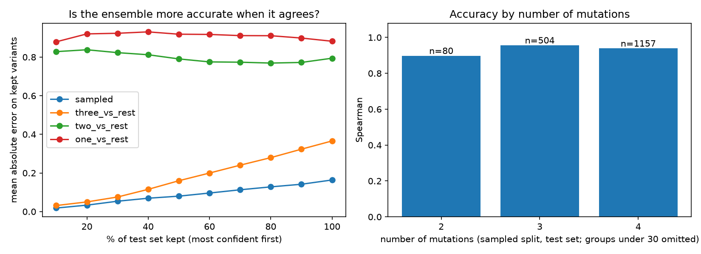

# gb1-fitness

Can a model trained on simple protein variants predict complex ones, and does it know when it is wrong?

I trained small neural networks to predict protein fitness on the GB1 landscape and tested them
on splits that force extrapolation from fewer mutations to more. The short answer: networks capture
interactions between mutations very well when they have seen combinations, do no better than an
additive model when they have not, and their confidence stops meaning anything in exactly that case.

## Data

GB1 from the [FLIP benchmark](https://github.com/J-SNACKKB/FLIP/tree/main/splits/gb1): variants of
protein GB1 mutated at four positions (V39, D40, G41, V54), each with a fitness value from a binding
assay (Wu et al., eLife 2016). The original landscape covers about 160,000 variants; each FLIP split
file contains 8,733. About a third of variants are non-functional (fitness below 0.1), and almost none
fall between 0.1 and 0.5, so fitness is closer to two populations than one smooth scale
(`fitness_hist.png`).

| Split | Trained on | Tested on |
|---|---|---|
| sampled | random 80% | random 20% |
| three_vs_rest | 0 to 3 mutations | 4 mutations |
| two_vs_rest | 0 to 2 mutations | 3 and 4 |
| one_vs_rest | 0 and 1 mutation | 2, 3 and 4 |
| low_vs_high | variants worse than wild type | the rest |

## Method

- **Input:** the four varying positions, one-hot encoded (80 numbers). The other 261 positions never change.
- **Additive baseline:** ridge regression. Each mutation contributes a fixed amount regardless of the others.
- **Network without ReLU:** the same network with the non-linearities removed, which makes it additive too.
- **MLP:** two hidden layers of 128 units with ReLU, trained with Adam and mean squared error.
- **Early stopping:** the FLIP validation rows are held out of training; each model keeps the weights
  from its epoch with the lowest validation loss (patience 25, at most 300 epochs).
- **Seeds:** every network is trained five times with different seeds.
- **Ensemble:** the average of the five MLPs. Their disagreement (standard deviation) is used as uncertainty.
- **Metric:** Spearman correlation on the test set. Intervals are 95% bootstrap intervals over test
  variants (1,000 resamples). Network rows without intervals report mean ± standard deviation across seeds.

## Results

| Split | Train / val / test | Additive (ridge) | Network without ReLU | MLP, 5 seeds | Ensemble of 5 |
|---|---|---|---|---|---|
| sampled | 6289 / 699 / 1745 | 0.788 [0.766, 0.807] | 0.787 ± 0.002 | 0.945 ± 0.002 | **0.954** [0.948, 0.959] |
| three_vs_rest | 2691 / 299 / 5743 | 0.750 [0.738, 0.760] | 0.753 ± 0.005 | 0.869 ± 0.004 | **0.881** [0.876, 0.886] |
| two_vs_rest | 381 / 43 / 8309 | **0.561** [0.545, 0.576] | 0.547 ± 0.007 | 0.520 ± 0.022 | 0.546 [0.529, 0.561] |
| one_vs_rest | 25 / 3 / 8705 | **0.280** [0.259, 0.297] | 0.171 ± 0.052 | 0.195 ± 0.064 | 0.238 [0.217, 0.259] |
| low_vs_high | 4580 / 509 / 3644 | 0.345 [0.317, 0.374] | 0.338 ± 0.011 | 0.579 ± 0.008 | **0.635** [0.613, 0.656] |



Left: mean absolute error on the test variants the ensemble is most confident about, adding less
confident ones from left to right. Right: accuracy by number of mutations on the random split.

## What I found

1. **The gain comes from interactions between mutations (epistasis).** Removing the ReLU layers drops the
   network to the additive model's score (0.787 against 0.788). Everything the MLP gains above that is
   non-additive structure.
2. **Networks only learn interactions they have seen.** With triple mutants in training, the MLP beats the
   additive model by a wide margin (0.881 against 0.750 on quadruple mutants). Trained on single and double
   mutants only, it does no better than additive, and with single mutants only it does worse.
3. **Confidence is informative only where the model is already accurate.** On the random and three_vs_rest
   splits, error rises steadily as less confident predictions are included. On two_vs_rest and one_vs_rest
   the curve is flat: the ensemble is just as wrong when it agrees as when it does not.
4. **Disagreement partly tracks prediction size.** Larger predicted fitness comes with both larger errors and
   larger spread. Within quintiles of predicted fitness, disagreement still correlates with error on the
   random and three_vs_rest splits (Spearman 0.28 and 0.29), about half the raw figure (0.59 and 0.66).
   On the extrapolation splits it stays near zero (0.03 and -0.03).

The practical point for protein design: a model fitted to single mutants will propose combinations it
cannot score, and its own uncertainty will not warn you.

## Limitations

- One encoding, one small architecture and no hyperparameter search. Better models may extrapolate better.
- one_vs_rest has 3 validation rows, so early stopping there is close to arbitrary.
- Bootstrap intervals cover test-set sampling, not training randomness, which is reported separately as
  the spread across seeds.
- The ensemble differs only in initialisation and data order. It is a weak uncertainty estimate, and
  stronger ones might behave differently.
- Spearman only. The two-population shape of fitness suggests separating "works or not" from "how well"
  would be worth testing.

## Reproduce

```bash
python3 -m venv .venv && source .venv/bin/activate && pip install -r requirements.txt
curl -L -o data/splits.zip https://github.com/J-SNACKKB/FLIP/raw/main/splits/gb1/splits.zip
unzip -o data/splits.zip -d data      # files land in data/splits/
python explore.py                     # data summary, histogram, ridge on every split
python run_all.py                     # everything above, about 80 seconds on a laptop CPU
```

`train.ipynb` is the first network built step by step, run on a Colab GPU. `gb1.py` holds the shared
code and `run_all.py` produces the table, `results/results.json` and the figure.
